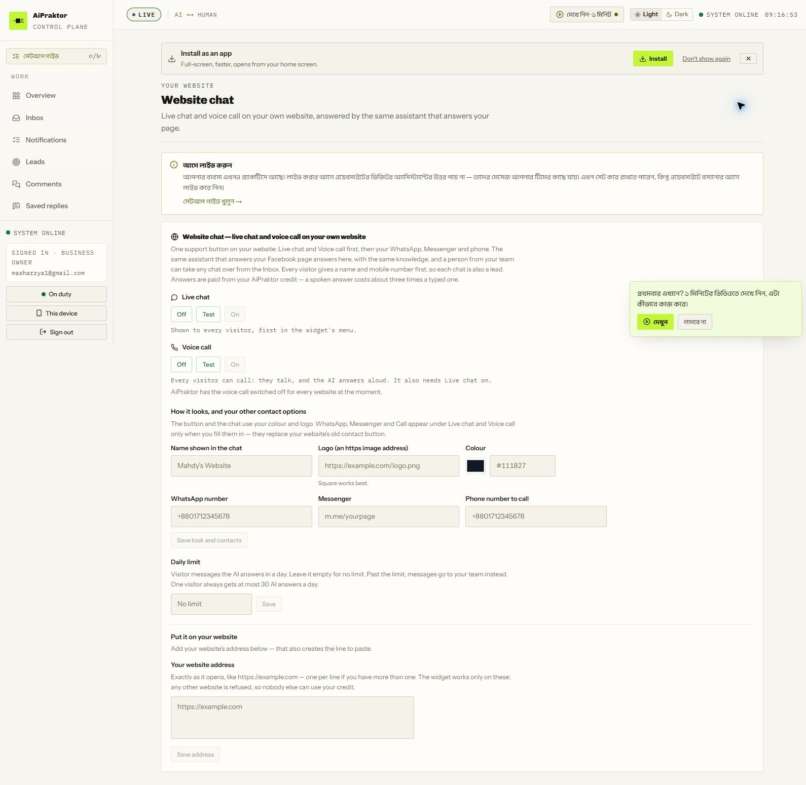

# AiPraktor dashboard audit

তারিখ: ১১ অক্টোবর ২০২৬। Source: ব্যবহারকারীর Chrome-এ signed-in [AiPraktor dashboard](https://www.aipraktor.com/dashboard)। এটি competitor UI audit; Ekmivo-এর নতুন implementation plan নয়।

## কী দেখা হয়েছে, কী প্রমাণিত নয়

২৩টি প্রধান sidebar destination, Orders-এর পাঁচটি subpage, Groups, Facebook ও Website channel detail এবং workspace settings মিলিয়ে **৩২টি পৃথক route** দেখা হয়েছে। Setup-এর সাতটি step, product tabs, lead views, moderation rules, order filters, broadcast formats/offers, labels, reply variables এবং permission editor-ও দেখা হয়েছে। মোট ১৫৭টি snapshot সংরক্ষিত। Setup-guide একই Overview-এর anchor; আলাদা page হিসেবে গণনা করা হয়নি।

এই account practice mode-এ; Facebook connected নয়, credit নেই এবং customer conversation, product, order, lead, campaign ও courier booking নেই। ফলে নিচের তালিকা **দেখা control ও UI-তে বর্ণিত আচরণের inventory**। বাস্তব message delivery, AI correctness, payment processing, stock concurrency, courier বা authorization নিরাপত্তা পরীক্ষার দাবি নয়। Loading অবস্থার প্রথম snapshot পরে loaded snapshot দিয়ে পড়তে হবে।

Evidence: [সম্পূর্ণ UI inventory](./AIPRAKTOR-UI-INVENTORY.md), [coverage CSV](./aipraktor-dashboard-coverage.csv), [redacted snapshots](./evidence/aipraktor-ui-snapshots.json)। Inventory-তে প্রতিটি দেখা field, option, label, help text ও modal রাখা হয়েছে; এই report সেগুলোর সংগঠিত ব্যাখ্যা। Email, payment number, bank identifier ও recharge reference redacted।

## Audit-এর সময় অনিচ্ছাকৃত পরিবর্তন

Website chat-এর **Set up website chat** button form খোলার পরিবর্তে default website configuration এবং “Mahdy's Website” channel তৈরি করেছে। এটি আমার অনিচ্ছাকৃত পরিবর্তন; আগে UI দেখে এই side effect বোঝা যায়নি। Website switch checked; address ফাঁকা, embed snippet install করা হয়নি, workspace practice mode-এ এবং conversation শূন্য। UI-র practice warning অনুযায়ী live হওয়ার আগে visitor AI reply পায় না। কোনো website origin, credential, payment, invitation, customer message বা campaign submit করা হয়নি। Configuration delete বা off করার অতিরিক্ত পরিবর্তন করা হয়নি।

## সাধারণ application shell

- Sidebar Work/Grow/Set up/Help us improve ভাগে সাজানো; setup progress, business identity, owner role, On duty, This device ও Sign out থাকে। On duty-এর ব্যাখ্যা human handover notification-এর সঙ্গে সম্পর্কিত।
- Header-এ LIVE AI ↔ HUMAN, clock, Light/Dark radio এবং SYSTEM ONLINE/auto-revert sweeper indicator। LIVE label থাকলেও business practice mode—দুটি status-এর অর্থ এক নয়। Theme পরিবর্তন করে persistence পরীক্ষা করা হয়নি।
- PWA install banner: Install, Don't show again, Not now। Browser permission/install চালানো হয়নি।
- Page-specific tutorial button ও প্রথমবারের video prompt। EN/BN switch কিছু panel-এ আছে; পুরো navigation ও সব field একসঙ্গে অনুবাদের প্রমাণ পাওয়া যায়নি।

## ১. Overview — `/dashboard`

Setup guide-এর pre-live আটটি কাজ: Facebook connect, business information, AI credit, products, customer payment rules, phone notification, assistant test, go live। Credit Facebook connection-এর পরে স্বয়ংক্রিয়ভাবে আসার কথা UI-তে লেখা। Practice-এ শুধু test chat; live-এর আগে customer Messenger reply Meta থেকে দিতে বলা হয়। Trial শুরু live-এর পরে।

Post-live checklist: first customer reply, team, website chat/voice, Instagram, courier। Provider-managed item: WhatsApp account manager-এর মাধ্যমে; knowledge/follow-ups/broadcasts চালু থাকার বর্ণনা।

৭/১৪/৩০ দিনের metrics: conversations, AI handled %, waiting human, follow-ups due, pipeline value, won। Waiting queue, page summary, activity, AI/Human/Reverting split, handoffs ও reversions, average/median first reply, late percentage, pipeline এবং team overview। Human response clock প্রথম claim থেকে গণনার ব্যাখ্যা আছে। খালি account-এ populated rows ও তাদের actions দেখা যায়নি।

## ২. Inbox — `/dashboard/inbox`

Name/phone/message search; Waiting/Unread/Open/Done; All/Mine; Everyone/With person/AI/Not customer ownership; label, date এবং newest-first filter। Keyboard: search `/`, up/down, Enter, `E` done। Conversation না থাকলে detail pane নির্বাচন করতে বলে।

Date popup: Any time, Today, Yesterday, Last 7/30 days, This/Last month; calendar navigation, From/To এবং Apply range। Customer যে দিনে লিখেছে, local timezone অনুসারে filter—UI-র ব্যাখ্যা।

Labels: New customer, Payment pending, Paid, Repeat customer, Complaint; label search/count। Manager-এ rename, colour cycle, reorder, remove ও add; সর্বোচ্চ ৩০টি। Definition edit owner-এর, team assignment করতে পারে; পরিবর্তন autosave বলে লেখা, তাই edit করা হয়নি। Alerts click-এ দৃশ্যমান settings dialog পাওয়া যায়নি; device notifications off-ই আছে। Actual composer, send, media, handover ও customer detail data না থাকায় দেখা যায়নি।

## ৩. Notifications — `/dashboard/notifications`

Human-clear না হওয়া handover, AI alert, handed-back ও follow-up records-এর বর্ণনা। ৭/৩০/৬০ দিন ও all; Waiting/Past target/Never answered/Done metrics; Needs attention/Done/All views; Given to me। Type filter: Everything, Handovers, AI alerts, Followups, Calls, Bookings, Payments, Website leads, Requests। কোনো record না থাকায় resolve/reassign/detail actions পরীক্ষা হয়নি।

## ৪. Leads — `/dashboard/leads`

Page filter; Open/Pipeline value/Due today/Won metrics; Today/Pipeline/List/Results চার view। Stages: New, Contacted, Qualified, Follow-up, Won, Lost। পুরোনো won/lost load করার control; Results ৩০/৯০ দিন। Today-তে নতুন message, due follow-up বা missing next step-এর ব্যাখ্যা।

Search name/phone/need/notes; Anyone/Mine/Unassigned; priority high/normal/low, source, channel, added date; CSV; J/K/Enter/search shortcuts। Add lead form: page, Facebook/Instagram/WhatsApp/Phone/Other, name, phone, email, value, priority, stage, intent with dictation, assignee picker, follow-up date ও next-step note। Save করা হয়নি; populated lead editing/activity/conversion দেখা যায়নি।

## ৫. Comments — `/dashboard/comments`

Comments ও Posts view; ৭/৩০/৯০ দিন; All/Needs you/Unanswered/Complaints/Removed; comment/name search। Posts view-তে answered/removed ও first-comment-এর পরে order attribution-এর বর্ণনা।

Rules modal: confident junk Delete অথবা Hide; unsure junk hide+human alert; complaints AI answers+notify অথবা human-only; public phone hide করে lead-এ রাখার switch। সর্বোচ্চ ৫০ blocked keyword, Hide/Delete action। Blocked people section আছে; Facebook-এর বাইরের block list এখানে নয় বলে লেখা। Save rules disabled ছিল। কোনো comment reply/delete/block চালানো হয়নি।

## ৬. Saved replies — `/dashboard/saved-replies`

Name, slash shortcut, folder, Shared team/Only me, sample questions; ordered multi-message reply। Text সর্বোচ্চ ২০০০ characters; আরও message, photo ও নিজের recorded voice। Preview, AI automatic answer, pin, Suggest fitting reply ও Adapt with AI। AI adaptation numbers/prices/links না বদলানোর দাবি UI-তে আছে; পরীক্ষা হয়নি।

Insert-variable popup: salutation, customer first name; order number/total/delivery/COD/status/tracking/bill; business name/delivery areas/how to pay/phone/address/hours; product price/name/link; reply sender name। Search, All/Shared/Mine/Archived। Existing reply না থাকায় restore/edit/use-in-chat পরীক্ষা হয়নি; voice/media upload করা হয়নি।

## ৭. Orders এবং পাঁচটি subpage

`/dashboard/orders`: source All/AiPraktor/Store, page, name/phone/order search, test orders, filters, Export ও New order। Stages: All, Pending, On Hold, Exported, Approved, Processing, Ready to Ship, In-Transit, Delivered, Flagged, Cancelled, Store। Delete নয়, cancellation—UI-র নীতি।

Filters: Created/Approved/In-Transit/Delivered/Cancelled date; taken by Anyone/AI/Product page/person; assignee; courier Any/Steadfast/Pathao/RedX/eCourier/None; courier status, booked/not, invoice printed/not, advance paid/none; Messenger/Instagram/WhatsApp/Website; hold/cancel reason; inside/outside Dhaka/unknown, insufficient stock ও city। সব reason-এর exact তালিকা UI inventory-তে।

New order: page, customer, phone, address, city; COD/bKash/Nagad/Bank/Other; catalog product বা custom name/price/quantity; delivery, discount, coupon, advance। Subtotal/total/COD due breakdown, server repricing note; packer/rider note এবং private team note, dictation। কোনো order তৈরি হয়নি।

Export menu: one row/order, one row/item; **Export and hand off** এবং Export history। History-এর ব্যাখ্যা অনুযায়ী handoff Pending থেকে Exported-এ নেয়—সাধারণ download থেকে আলাদা mutation। এটি চালানো হয়নি।

| Subpage | দেখা controls ও সীমা |
|---|---|
| Customers `/orders/customers` | প্রতি mobile-এ customer; search, order date, purchased product code, city, minimum orders, no-order-since; records নেই |
| Scan `/orders/scan` | Invoice barcode বা typed order number, Enter/Add, Use camera; scanned orders bulk change-এর বর্ণনা; camera permission নয় |
| Courier `/orders/handover` | গত ৪৫ দিনের courier-held cash, refresh; courier/day handover sheet, Dhaka date, print; নিজেদের booked orders মাত্র, courier panel-এর সব parcel নয় |
| To chase `/orders/incomplete` | Buy/lead/offer interest কিন্তু order হয়নি; To chase/Contacted/All, ৭/১৪/৩০ দিন; empty |
| Report `/orders/report` | Date range, page; ordered period, taker ও outcome-এর বর্ণনা; no orders, populated report metrics দেখা যায়নি |

Delivery settings-এর linked `/dashboard/workspaces/{id}`-এ **Owner only** দেখা গেছে, যদিও sidebar Business owner বলে। Permission/context অসামঞ্জস্য; কারণ বা backend vulnerability প্রমাণিত নয়। Order detail, invoice output, real coupon/advance/stock/courier lifecycle অদেখা।

## ৮. Activity — `/dashboard/activity`

Mode-change audit stream; CSV; All sources/Dashboard/AI/Auto-revert/Bulk/Answered filters। Real-time STREAMING label, কিন্তু কোনো activity record নেই। Immutability বা export content পরীক্ষা হয়নি।

## ৯. Analytics — `/dashboard/analytics`

Overview: ৭/১৪/৩০ দিন; incoming/outgoing, AI/human, people/conversations; daily/hourly messages; AI-only বনাম human step-in; first-response medians; types/channels/pages; follow-up metrics; handoff/reversion volume, average human response/SLA breach/waiting/longest wait; source/day/page breakdown। Asia/Dhaka; নিজস্ব history, Facebook analytics নয়। Conversation-first response ও claim-start SLA clock আলাদা বলে ব্যাখ্যা।

People: ৭/৩০/৯০ দিন; sortable person, chats, taken over, given, answered, replies, typical reply, in time, leads won/lost, dropped, not opened। ১০-এর নিচে chats হলে speed judgement দেখায় না; previous equal period comparison। Reply attribution October 2026 থেকে বলেছে। খালি sample-এ performance accuracy বিচার করা যায়নি।

## ১০. Follow-ups — `/dashboard/followups`

UI অনুযায়ী ৩ quiet hours-এ warm/hot বিচার; hot ৩ ও ২০ ঘণ্টায়, warm ২০ ঘণ্টায় reminder; সর্বোচ্চ ২/visit, ২৪ ঘণ্টার messaging window-এর মধ্যে। Human-owned, ordered বা declined হলে silence with reason। ৭/১৪/৩০ দিনের watching/planned/sent/replied/ordered metrics। Per-page ON, Both/Hot only/Warm only; switch-off scheduled work বাতিলের ব্যাখ্যা।

Watching/Upcoming/Sent/Skipped/For the team/All সব view দেখা হয়েছে; missed window human team-এর কাছে যায়। Last reminder offer editor: recipient class, %/fixed discount/free delivery/custom, amount, ২/৬/১২/২৪/৪৮ ঘণ্টা, prefix ও sentence। UI-র এক জায়গায় discount card without code, editor-এ store coupon ব্যবহারের তথ্য আছে—channel/store-specific exact behavior পরীক্ষা প্রয়োজন। Save বা reminder send হয়নি।

## ১১. Broadcasts — `/dashboard/broadcasts`

New, Drafts & scheduled, Sent; page switch। Recipient selector: recent ১–২৩ ঘণ্টা, Messenger/Instagram/both, hot/warm/none, previous purchase, last-broadcast exclusion ৬–১৬৮ ঘণ্টা, recipient count। UI নিজস্ব safety cutoff ২৩ ঘণ্টা বলে; এটিকে independent Meta-policy verification বলা যাবে না।

Formats সব দেখা: text; text+quick replies; buttons/postback+optional link; one product card; carousel সর্বোচ্চ ১০; discount card; photo URL। Offers: none, % off, fixed ৳ off, free delivery, selected-product special price, custom; expiry ১/২/৬/১২/২৩ ঘণ্টা, optional coupon code, message এবং preview। Draft save, নিজের phone-এ test-এর পরে send/schedule-এর বর্ণনা। কোনো draft/test/campaign তৈরি হয়নি; history খালি।

## ১২. Products — `/dashboard/products`

Catalog/Sync/Photos/Stock/Numbers। Counters: product/photo/featured/hidden/edited/removed; code/name/category search; featured/hidden/not ready/no-photo/panel-edited/source-removed filters।

Add: main photo upload/URL; সর্বোচ্চ ১০ extra photo; mobile compression-এর copy; name, BDT price, unique code, category, description/dictation, availability। Option labels Size/Colour/Weight/Volume/Pack/Type/custom; presets; two dimensions, combination generation, variant stock ও price override। Price blank/zero হলে quote না করা; zero counted stock unavailable; indexing cost estimate দেখায়। Save করা হয়নি।

Sync: upload-here অথবা WooCommerce। Store URL ও read-capable consumer key/secret; product-created/updated/deleted webhook setup instruction। Credentials দেওয়া হয়নি। CSV/XLSX first sheet, preview before approval, missing products removed-state; required code/name/price/photo, optional description/video/featured/available/photo2–6/regular price/link/options। Ignored column existing data preserve; active blank price/link clear, blank options preserve, panel-owned options protected—UI copy। Video code/link file আলাদা, empty removes video। Template/download/sync-history controls।

Photos: photo+optional text অথবা question দিয়ে retrieval test, history type/date filters। Counters: Matched, Asked/nearest, Not ours/similar offered, No answer/no credit or indexing; question searches/by-code। No product/credit/test তাই actual match বা history detail অদেখা। Stock: enabled, item/count/on-hand/reserved/available/courier/return counters; uncounted unlimited, counted zero out। Numbers: ৭/৩০ দিনের product view/Buy now/product-page orders; chat/manual order বাদ দেওয়ার copy।

## ১৩. Posts — `/dashboard/posts`

Customer-এর প্রথম comment-এর পরে একবার post/photo recognition; প্রতি photo product matching এবং বর্তমান price। ভুল হলে product code বা None দিয়ে correction মনে রাখার বর্ণনা; caption-এ product code-এর পরামর্শ। কোনো post নেই, per-photo mapping/correction দেখা যায়নি।

## ১৪. Knowledge — `/dashboard/knowledge`

Text/document অথবা Q&A upload; title, file, pasted body, dictation; headings/paragraph/Q:/A: parsing instruction, character count, Add & index। Search-question test। Business facts যেমন hours/address/payment number আলাদা রাখতে বলে। No ingestion/query করা হয়নি; indexed entry edit/delete/chunk detail অদেখা।

## ১৫. Website chat — `/dashboard/website`

Shared assistant/knowledge এবং Inbox takeover; visitor name/mobile নিয়ে lead। Live chat ও voice Off/Test/On radio। Voice provider globally disabled বলে লেখা, যদিও On checked—effective availability অস্পষ্ট; operational voice দাবি করা যাবে না। Spoken answer প্রায় ৩× typed cost-এর estimate।

Brand name, https logo, colour picker+hex, WhatsApp/Messenger/phone; daily global AI answer cap, visitor cap ৩০/day, overflow-to-team। Exact origin allowlist; address save করলে embed snippet তৈরি; unlisted site refuse-এর বর্ণনা। Origin খালি, install হয়নি। Website page detail-এ shared offers/review/upsell মূল Facebook page-এর settings থেকে আসে; follow-ups/broadcasts সেখানে OFF এবং provider-managed।

## ১৬. Agent Desk — `/dashboard/agent-desk`

BN/EN, natural-language change request/dictation; proposed change → consent → draft → actual-agent test → explicit publish-এর বর্ণনা। Account manager setup না হওয়ায় actual testing unavailable। Last ৩০ দিনের unanswered questions panel, business name/hours editor।

Instruction blocks: About shop; Delivery charges/times/shipping; Your voice; Exact words; Anything else; নতুন block। Editor-এ name/body, cancel/draft save। Test message, continue-conversation checkbox; setup status, last test, ২৪ ঘণ্টার count; published version ও rollback। কোনো draft/test/publish হয়নি; version history/activation বাস্তবভাবে অদেখা।

## ১৭. Pages ও channel detail — `/dashboard/pages`

Facebook/attached Instagram/WhatsApp connection; one-business constraints এবং disconnected হলেও message-retention-এর ব্যাখ্যা। WhatsApp contact manager-এর মাধ্যমে; Facebook কখনও connected হয়নি। Reply delay/grouping ০–১৫ seconds; photos পৃথক timer বলে লেখা। AI channel switches autosave, তাই পরিবর্তন করা হয়নি।

Detail: Total/AI/Human/Reverting/Waiting counts, search name/ID/message/note, all/ai/human/temp/waiting filters। Settings: page name; auto-revert ৩০m–২৪h অথবা minutes; human SLA ৫–৬০m অথবা minutes; Allow replies/View-only; auto-lead on handoff; provider-managed follow-ups/broadcasts।

Business-owned review request, URL, delay default ১৪৪০m, custom text; delivery-problem notification, সর্বোচ্চ ১/২০h/order; related-product upsell/coupon/text; special offer product code/label/start/end/AI sentence, base price না বদলানোর copy। Save হয়নি। Live connection, auto-revert বা review-message send পরীক্ষা হয়নি।

## ১৮. Billing — `/dashboard/billing`

Observed offer: monthly fee নেই, usage-based shared credit। Minimum top-up ৳১০০০; presets ১০০০/২০০০/৫০০০/১০০০০/custom; **৫০% service charge**। ৳১০০০ দিলে ৳৫০০ AI credit ও আনুমানিক ২২৬২ replies দেখিয়েছে—estimate, guaranteed economics নয়।

bKash/Nagad personal Send Money অথবা bank transfer; reference; required TrxID এবং optional sender/account/note; platform checks payment তারপর credit। **এটি competitor-এর নিজস্ব SaaS recharge flow। আমাদের customer payment auto-verification-এর পরিবর্তে এই TrxID-entry flow গ্রহণ করা যাবে না।** Merchant customer payment-এর automatic sender/time matching এখানে দেখা যায়নি।

Balance warning default ৳১০, Change editor; top-up history; ৩০/৯০/৩৬৫-day statement CSV। Request usage: today/yesterday/৭/৩০/৯০/this/last month/custom, purpose ও success/failure; spent/requests/customers/input/output tokens/per request। Provider-reported actual cost BDT conversion বলে copy। Credit non-expiry/non-refundable terms link; কোনো payment/terms acceptance হয়নি।

## ১৯. Team এবং Groups

`/dashboard/submasters`: separate teammate login; name/email, group presets, whole-business অথবা specific page access; invitation। Presets Manager/Inbox/Orders/Delivery/Products/Accounts। Owners সর্বোচ্চ ৩; additional-owner form broad access দেয়। Immutable change audit-এর বর্ণনা। কোনো invite/owner তৈরি হয়নি।

`/dashboard/groups`: Manager, Inbox, Orders & delivery, Products, Accounts; extra ready Sales/Bookings/Marketing/Viewer; new/copy/open/archive controls। Manager permission editor দেখা হয়েছে: Inbox/Leads/Orders/Products/Bookings/Followup/Broadcast/AI/Knowledge/Team/Billing/Connections/Settings-এ No access/Can see/Can do; Reports-এ read-only বা none।

Sensitive permissions: cancel order, export, broadcast send, courier money; own/unassigned row restriction; handover reasons; members ও optional expiry। একাধিক group-এ most-generous permission; last group সরালে access নেই—UI-র ব্যাখ্যা। কোনো permission save বা security test হয়নি।

## ২০. Setup — `/dashboard/setup`

সাতটি step সব দেখা: Facebook, Business, Products, Notifications, Courier, Team, Go live। Facebook Meta connect-এ optional Instagram; app review pending workaround/account-manager help আছে। OAuth করা হয়নি। WhatsApp provider enable/cost separate।

Business: text/voice-assisted autofill with preview/save; physical/service-booking/both; description/hours/hotline/address; inside/outside Dhaka delivery charge/min–max duration, cutoff ও off-days; order-status message switches; extra free-shipping/advance/weight rules; free-form payment ও returns। Reply BN/EN/auto, voice/tone, formal salutation/name/greeting। Model পরিবর্তন বা save হয়নি।

Products inline/manual অথবা bulk/store link। Notification browser enable; Team invite। Courier manual, Pathao (ID/secret/store ID), Steadfast (API key/secret)। Order filters-এ RedX/eCourier থাকলেও onboarding-এ তাদের credential form দেখা যায়নি। Credentials/webhook/live booking পরীক্ষা হয়নি।

Go live checklist ০/৮; Facebook prerequisite, own Messenger test-code flow; trial শেষে AI stops কিন্তু data remains, recharge resumes; no-card/data-deletion copy। Go live বা message test চালানো হয়নি। Booking mode-এর আলাদা dashboard navigation এই account-এ পাওয়া যায়নি।

## ২১–২৩. Video guide, Feedback, This device

- `/videos`: loaded অবস্থায় **৪১টি tutorial**, একটি seen marker। Setup/booking, inbox takeover/organization, order courier/export/subpages, product image/stock/sync, groups, agent instructions/publish/training সহ module guides। সব title inventory-তে; video content একে একে playback/transcribe করা হয়নি।
- `/feedback`: BN/EN; feature/usability/bug; text বা ২-minute continuing dictation; সর্বোচ্চ ৪ screenshots; own feedback/status area empty। Submit হয়নি।
- `/device`: browser notification এবং Inbox sound off; turn-on ও PWA install help। Device-local preference-এর copy। Notification/microphone/camera/PWA permission নেওয়া হয়নি।

## যে অংশগুলো দেখা সম্ভব হয়নি

| সীমা | বাদ পড়তে পারে এমন detail | কারণ |
|---|---|---|
| Actual customer records | Composer/media/send receipt, chat ownership history, lead/order detail, inline bulk actions | Account empty |
| Connected channels | Meta OAuth permission details, Instagram/WhatsApp operational screens, reconnect/live send | Facebook disconnected; provider setup নয় |
| Agent runtime | AI change proposals, test output, draft diff/publish/version rollback | Account-manager setup incomplete; credit নেই |
| Commerce | Order invoice/tracking/refund/advance/coupon/stock adjustment/courier settlement populated views | No orders/products/bookings |
| Service booking | Calendar, slot/resource/customer booking detail | Current business configuration-এ navigation অনুপস্থিত; model save করা হয়নি |
| Owner settings | Workspace settings details | Owner-only restriction |
| Retrieval/import | Upload preview validation, sync diff, image result correction, knowledge chunks | কোনো file/credential/test submit হয়নি |
| Billing/campaign history | Real transactions, failure messages, scheduled/send/retry details | Histories empty |
| Theme/mobile/video | Dark persistence, responsive mobile layout, all tutorial contents | Scope ছিল dashboard feature inventory; presentation/functional QA নয় |

এগুলোকে “feature নেই” বলা হয়নি। এই account-এ দেখা যায়নি; সব record-dependent hidden actions সম্পর্কে ১০০% coverage দাবি করা সঠিক নয়। Inventory-র visible options সম্পূর্ণভাবে সংরক্ষণ করা হয়েছে, অদেখা অংশ এই তালিকায় খোলা আছে।

## Ekmivo-তে কাজে লাগবে এমন সিদ্ধান্ত

এগুলো competitor observation থেকে recommendation; canonical scope বা user decision বদলানোর নির্দেশ নয়।

1. Inbox, lead, order, customer ও payment একই customer context থেকে reachable করা; একই তথ্য বারবার চাইবে না।
2. Handover ownership, SLA start, auto-return, waiting queue এবং notification clear-এর অর্থ explicit রাখা; conflicting LIVE/practice status এড়ানো।
3. Simple CSV download এবং state-changing export/handoff আলাদা করা; UI label দিয়ে side effect আগেই বোঝানো। Website setup-এর accidental creation-ও এই design সমস্যার বাস্তব উদাহরণ।
4. AI draft/test/publish/rollback আলাদা stages; instruction, knowledge, catalog ও exact payment truth আলাদা authority।
5. Feature entitlement, channel connection, account-manager gating ও business mode আলাদা status; voice On + globally disabled ধরনের contradictory state এড়ানো।
6. Credit warning, usage details, daily caps, per-visitor limit এবং exhausted-credit human flow স্পষ্ট করা।
7. পূর্ণ EN/BN, Hind Siliguri, light/dark ও Ekmivo-এর selected tokens বজায় রাখা; competitor-এর mixed localization/design সরাসরি কপি নয়।
8. আমাদের payment flow-তে actual sender + transaction time + amount + receiving account + method-এর unique match স্বয়ংক্রিয় confirm/webhook করবে। Competitor recharge TrxID UI এটি বদলায় না; এই audit থেকে Ekmivo phone bridge verified বলা যাবে না।

Implementation এখনও `docs/DUAL-SAAS-MVP-PLAN.bn.md` অনুসারে হবে। Audit-এ নতুন দৃশ্যমান capability পাওয়া মানে সেটি Ekmivo-তে implemented বা tested নয়।

## Repository sync evidence

Audit report তৈরি হওয়ার পরে `git pull --ff-only origin main` সফল: `3efd479` → `164afe8`। ৪৯টি tracked file-এ remote updates এসেছে; audit artifacts অক্ষত। এই কাজের scope-এ নতুন implementation, migration, deployment বা নতুন remote code-এর functional verification হয়নি। Report ও evidence local untracked artifacts; GitHub-এ publish করা হয়নি।
